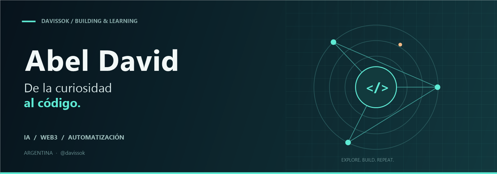

  

  

  
  

<h3 align="center">Aprender. Construir. Compartir.</h3>

  Soy <b>Abel David</b>, de Argentina 🇦🇷 
  Exploro la inteligencia artificial, la automatización y la Web3 
  creando proyectos y aprendiendo en el proceso.

---

### 🧭 Lo que me mueve

- **IA aplicada:** explorar agentes que conecten conversaciones con herramientas y tareas útiles.
- **Automatización:** hacer que el código trabaje por mí, incluso con tareas diarias en GitHub Actions.
- **Web3:** seguir aprendiendo sobre blockchain, Solidity y Move.
- **Experimentación:** probar ideas, construir prototipos y compartir lo aprendido.

### 🛠️ Mi caja de herramientas

  

  Python &nbsp;·&nbsp; FastAPI &nbsp;·&nbsp; Next.js &nbsp;·&nbsp; GitHub Actions
    
  

En mis proyectos y experimentos. Siempre hay algo nuevo por aprender.

### ✨ Proyectos para explorar

<table>
  <tr>
    <td width="50%" valign="top">
      <h3>01 / Agente IA para ecommerce</h3>
      
Un asistente conversacional para explorar la aplicación de agentes de IA a la venta de suplementos.

      
<code>Python</code> <code>FastAPI</code> <code>LangChain</code> <code>Next.js</code>

      <a href="https://github.com/davissok/agente-langchain-ecommerce"><b>Explorar el código →</b></a>
    </td>
    <td width="50%" valign="top">
      <h3>02 / Plushie Dream 3D</h3>
      
Una landing interactiva con WebGL: una exploración visual que combina una colección de imágenes generadas con IA y una experiencia 3D.

      
<code>Three.js</code> <code>WebGL</code> <code>Diseño web</code>

      <a href="https://github.com/davissok/plushie-dream-3d"><b>Explorar el código →</b></a>
      &nbsp;·&nbsp;
      <a href="https://davissok.github.io/plushie-dream-3d/">Ver demo ↗</a>
    </td>
  </tr>
</table>

### 🌱 En mi radar

<b>Agentes de IA</b> &nbsp; / &nbsp; <b>Automatización</b> &nbsp; / &nbsp; <b>Solidity &amp; Move</b> &nbsp; / &nbsp; <b>Open source</b>

Me interesa conectar con personas que también estén aprendiendo y construyendo con estas tecnologías.

### 🐍 Código en movimiento

  <picture>
    <source media="(prefers-color-scheme: dark)" srcset="assets/github-snake-dark.svg" />
    <source media="(prefers-color-scheme: light)" srcset="assets/github-snake.svg" />
    
  </picture>
   
  Mis contribuciones, en movimiento. Actualizado cada día con GitHub Actions.

---

  <b>De la curiosidad al código.</b> 
  Un proyecto a la vez. 🐢

