  

   
  Current team

---

**[Plushie Dream 3D ↗](https://davissok.github.io/plushie-dream-3d/)**

Una experiencia web interactiva en 3D, creada con Three.js.

[Código fuente](https://github.com/davissok/plushie-dream-3d)
